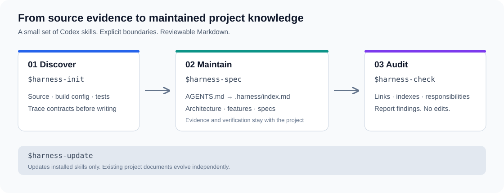

# HarnessKit

**让 AI 从真实代码建立项目知识，让下一次开发有据可循。**

一组面向 Codex 的 Skills：调查代码、维护契约、审计文档。把项目上下文保存在可审查的 Markdown 中，适用于已有代码库，也能为空项目建立基础框架。

**核心思想：让 AI 开发有依据、有约束、能验证、能积累。** 以代码为事实，用规则约束执行，通过检查发现偏差，再把确认的知识写回项目，成为下一次开发的起点。

[快速开始](#快速开始) · [四个入口](#四个入口) · [工作方式](#工作方式) · [常见问题](#常见问题) · [参与贡献](#参与贡献)



## 解决什么问题

AI 能写代码，但项目上下文容易在会话之间丢失：接口边界需要反复解释，已有文档可能与实现脱节，一次初始化生成的占位模板也未必能指导真实开发。

| 常见问题 | HarnessKit 的处理方式 |
| --- | --- |
| 每次都要重新解释项目 | 简短 AGENTS.md 提供规则，索引引导按需读取知识 |
| 文档写得完整，却缺少代码依据 | 从入口追踪调用链，重要结论关联源码路径与符号 |
| 新功能完成后，旧文档悄悄失效 | 增量维护相关 Feature / Spec，同步索引与验证记录 |
| 索引混入详细契约、文件漏登记或断链 | 脚本检查结构，Agent 审查职责，区分错误与疑点 |
| 更新工具时担心覆盖项目资料 | Skill 安装更新与项目文档维护分离，保护本地修改 |

## 为什么选择 HarnessKit

- **以代码为依据。** 已有项目先调查源码、构建配置与测试；真正无代码时才建立待填充框架。
- **知识留在仓库。** 普通 Markdown，可搜索、可审查、可随项目版本管理，运行不依赖在线 Page。
- **规则稳定，内容按需读取。** AGENTS.md 新增规则严格来自模板；架构、功能行为、共享契约各有位置。
- **维护有边界。** 同主题优先更新，不重复建档；未知项、规划与实现明确区分。
- **审计默认只读。** 发现问题先报告，不自动迁移内容或修改项目。

当前主要面向 **Codex**，文档结构不绑定特定编程语言。内容质量仍取决于源码调查与审查，不能保证模型永不遗漏。

## 快速开始

### 1. 安装四个 Skills

在支持 Skills 的 Codex 环境中发送：

```text
使用 $skill-installer，从 lugq/harness-kit 的 main 分支安装以下四个 Skill：
skills/harness-init
skills/harness-spec
skills/harness-check
skills/harness-update
```

辅助脚本需要 **Python 3.9+**；Skill 更新还需要 **Git**。安装后在下一轮输入 `$harness-` 选择入口；若列表未刷新，重新打开会话或重启客户端。安装发生在当前执行环境，不会自动同步到其他机器。

### 2. 初始化项目

打开目标项目，发送：

```text
$harness-init 初始化当前项目，根据真实代码生成知识文档，
保留已有资料与未提交修改。
```

已有知识目录时先明确处理范围，不覆盖或自动迁移旧资料。适用项目指令仍须遵循；其他旧文档只有在明确指定时才作为初始化参考。

### 3. 开发后维护，按需检查

```text
$harness-spec 根据真实代码，新增或更新视频导出 Feature，
同步索引和受影响的 Spec，不修改业务代码。
```

```text
$harness-check 检查当前项目的 Harness 文档，只报告问题，不修改文件。
```

这些是 **Codex Skill 调用**，不是系统终端命令。新增文档登记索引，已有主题优先更新。检查不会自动修复，也不会追加验证记录。

## 四个入口

| Skill | 什么时候用 | 产出与边界 |
| --- | --- | --- |
| [harness-init](skills/harness-init/SKILL.md) | 首次建立项目知识 | 调查源码，生成指令与文档；已有内容受保护 |
| [harness-spec](skills/harness-spec/SKILL.md) | 新功能、契约变化或补充知识 | 更新相关文档、索引和实际验证记录；不实现功能 |
| [harness-check](skills/harness-check/SKILL.md) | 检查累积的文档问题 | 只读报告结构错误、职责混用及证据疑点 |
| [harness-update](skills/harness-update/SKILL.md) | 获取新版 HarnessKit | 更新本机 Skills，不修改项目文档 |

## 工作方式

### 初始化：代码地图 → 证据 → 契约

先定位模块、公开入口、构建与测试，再沿输入、状态、输出、异常和资源释放追踪实现。Feature 描述具体能力，Spec 描述共享技术契约；关键结论就近关联代码依据，不用模板填空代替调查。

默认组织如下。具体技术与功能文件按项目实际生成，不为凑齐目录虚构内容：

```text
AGENTS.md                       # 稳定协作规则与知识入口
.harness/
├── index.md                    # 路径、用途、读取条件
├── architecture.md             # 模块职责、依赖与边界
├── verification.md             # 源码基准、调查覆盖与实际验证
├── features/
│   ├── README.md               # 编写指南
│   └── video-export.md         # 示例文件名，非预置功能
├── specs/
│   └── resource-lifecycle.md   # 示例文件名，非预置技术约束
└── decisions/
    └── README.md               # 有确认依据后增加决策记录
```

空项目使用内置框架，架构明确待确认，并包含默认 specs/development.md。这些默认协作约定会标明来源，不能冒充源码事实。

### 维护：开发结束后检查是否需要回写

相关验证有结果后、最终完成汇报前，检查是否产生长期知识或使已有内容失效：功能行为变化更新 Feature，共享契约变化更新 Spec，模块边界变化更新架构。没有知识变化就不改文档。

这依靠 Agent 遵循项目规则，**没有自动钩子强制回写**；需要时显式调用 `$harness-spec`。规划必须标记未实现，未执行验收不能写成通过。验证记录区分实际执行、缓存命中、无测试源和未执行原因。

### 审计：确定问题与判断性问题分开

结构脚本检查索引可达性、重复登记、用途与读取条件、本地内联链接。Agent 进一步审查索引是否承载详细契约、Feature / Spec 是否混用，以及重要结论的依据。

长文、TODO 或“待确认”不直接等于错误。源码一致性需要实际回读代码；外部 URL、锚点与复杂 Markdown 不在结构脚本的完整检查范围内。报告必须说明已查与未查范围。

## 更新与旧版迁移

```text
$harness-update
```

更新器先核验安装状态，暂存并校验新版，再替换各 Skill。普通异常会回滚；本地修改、额外文件或无法核验的安装会阻止覆盖。标准安装没有基线时，从仓库 main 历史核验完整文件哈希。

旧更新器只认识当时的入口：先更新已有 Skills，再调用一次新版 `$harness-update`，补齐缺少的 harness-spec / harness-check。更新 Skills 不覆盖项目已有文档。

默认通过 HTTPS 下载，支持现有 Git 凭据与 GitHub CLI 登录；可用 `--repo` 指定可信 SSH/HTTPS 地址，不修改全局 Git 配置。

高级检查可给更新脚本加 `--check`。更新被强制中断后，确认没有其他更新进程运行，再使用 `--recover` 恢复或清理事务。备份在事务完成前保留；多目录替换不是单次原子操作，也不保证恢复磁盘损坏。

## 常见问题

**已有 AGENTS.md 会被覆盖吗？**
保留原文，只补缺失的模板规则，语义等价的跳过；唯一允许的模板替换项是已确定的知识目录路径。选择保留入口时整个文件不改。

**必须使用 .harness 吗？**
这是新项目默认目录。已有自定义入口可以沿用，不能在未授权时自动迁移。其他目录职责由目标项目决定。

**检查会帮我修复吗？**
默认只报告。确认具体修复范围后，再通过维护流程处理。

**会读取所有旧资料，或提交我的代码吗？**
初始化不会自动导入其他记忆与规范；增量维护只读取相关知识。项目知识工作流不自动提交、推送、安装依赖或实现业务功能。

## 参与贡献

欢迎通过 Issue 提供可复现的问题，或通过 Pull Request 改进流程、模板与检查工具。反馈最好包含最小目录结构、调用方式、预期与实际结果，请使用脱敏示例。

仓库结构：`skills/` 存放四个可独立安装的 Skills，`tests/` 存放标准库回归测试，`assets/` 存放项目展示资源。

提交改动前运行：

```bash
python3 -m unittest discover -s tests -v
```

测试覆盖严格模板、索引与链接、只读审计、旧版补装、本地修改保护及失败恢复。修改 Skill 还应通过 skill-creator 的 `quick_validate.py`；它检查格式，不证明行为正确。init/spec 两份 Feature / Spec 模板需同步维护，一致性由测试检查。

## 致谢

源码调查后再提炼规范的流程参考了 [Trellis Spec Bootstrap](https://github.com/mindfold-ai/Trellis/tree/main/.agents/skills/trellis-spec-bootstrap)。HarnessKit 根据自身轻量范围独立整理流程，不依赖 Trellis，也不包含其完整任务管理系统。
